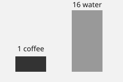

# Choosing beans

[Back to the contents](../index.md)

Buy whole beans roasted in the last few weeks.

## Roast levels

| Roast  | Taste               |
|--------|---------------------|
| Light  | Bright, acidic      |
| Medium | Balanced            |
| Dark   | Bitter, smoky       |

The chart above is the same file as on the first page, reached with `../`.
