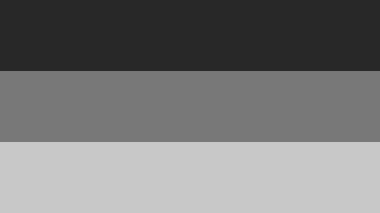

# Brewing Coffee at Home

This sample is one document split across several files. Every link and image
below is relative to this file and should open **inside the archive**.

## Chapters

1. [Choosing beans](chapters/01-beans.md), and its section on
   [roast levels](chapters/01-beans.md#roast-levels)
2. [Grinding](chapters/02%20Grinding.md) (the file name has a space, written
   `%20` in the link)
3. [Café au lait](chapters/03-café-au-lait.md) (non-ASCII file name, stored
   in Unicode NFC)

## Things to check

- The cover image above and the chart on the right both display.
- The chart floats right with text wrapping around it (`align="right"`).
- `manifest.json` uses both forms of a date: `created` is an object,
  `modified` is a plain string. Both are valid.
- [This link](https://mdzip.org) leaves the archive and should open in a
  browser, not inside your app.
